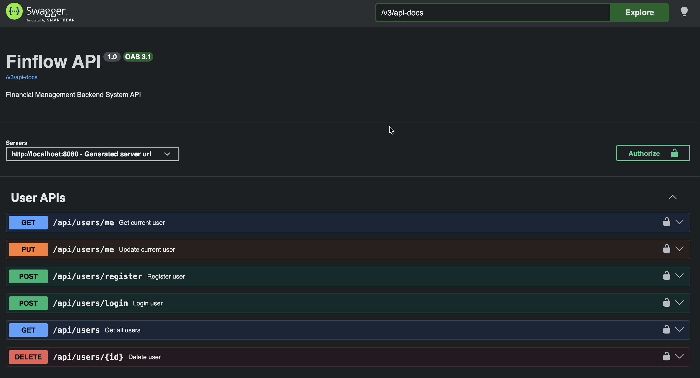
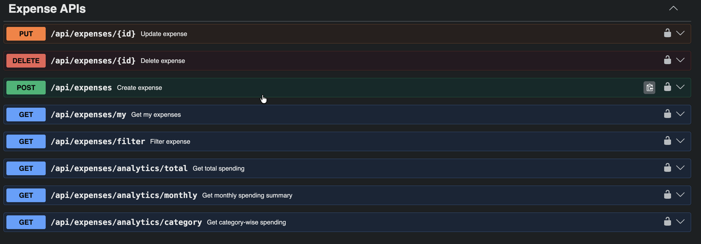

# FinFlow - Financial Management Backend System

FinFlow is a secure multi-user financial management backend system built using Spring Boot. It allows users to manage personal expenses with secure JWT authentication, role-based authorization, expense tracking, analytics, filtering, pagination, and sorting.


---

## Features

### Authentication & Security
- User Registration
- User Login
- JWT-based Authentication
- BCrypt Password Encryption
- Stateless Authentication
- Role-Based Authorization (USER / ADMIN)

### User Management
- Register User
- Login User
- Get Current Logged-in User
- Update Current User Profile
- Get All Users (ADMIN only)
- Delete User (ADMIN only)

### Expense Management
- Create Expense
- Get Logged-in User's Expenses
- Update Expense (Owner only)
- Delete Expense (Owner / ADMIN Access)
    - Owner can delete own expense
    - ADMIN can delete any expense

### Expense Analytics
- Total Spending
- Category-wise Spending
- Monthly Spending Summary

### Expense Filtering
Filter expenses by:
- Category
- Date Range
- Amount Range
- Keyword Search

### Pagination & Sorting
Supports:
- Pagination for large datasets
- Dynamic sorting by fields
- Ascending / Descending order

---

## Tech Stack

- Java
- Spring Boot
- Spring Security
- JWT Authentication
- Spring Data JPA (Hibernate)
- MySQL
- Maven
- Lombok
- Swagger / OpenAPI
- JUnit & Mockito

---

## Architecture

The project follows layered architecture:

```text
Controller → Service → Repository → Database
```

### Responsibilities
- **Controller Layer**
    - Handles HTTP requests/responses

- **Service Layer**
    - Contains business logic

- **Repository Layer**
    - Handles database operations using JPA

- **Security Layer**
    - JWT authentication and authorization

---

## Authentication Flow

1. User registers account
2. User logs in
3. JWT token generated
4. Token sent in Authorization header

Example:

```http
Authorization: Bearer your_jwt_token
```

JWT contains:
- Email (subject)
- Role
- Issued time
- Expiration time

---

## Security Features

- JWT-based stateless authentication
- Password encryption using BCrypt
- Role-based access control (USER / ADMIN)
- Owner-only access for expense modification
- ADMIN-level authorization for sensitive operations
- Secure API access using Bearer Token

---

## API Endpoints

### Authentication APIs

| Method | Endpoint | Access |
|--------|----------|--------|
| POST | `/api/users` | Public |
| POST | `/api/users/login` | Public |

### User APIs

| Method | Endpoint | Access |
|--------|----------|--------|
| GET | `/api/users/me` | Authenticated |
| PUT | `/api/users/me` | Authenticated |
| GET | `/api/users` | ADMIN |
| DELETE | `/api/users/{id}` | ADMIN |

### Expense APIs

| Method | Endpoint | Access |
|--------|----------|--------|
| POST | `/api/expenses` | Authenticated |
| GET | `/api/expenses/my` | Authenticated |
| PUT | `/api/expenses/{id}` | Owner |
| DELETE | `/api/expenses/{id}` | Owner / ADMIN |

### Analytics APIs

| Method | Endpoint |
|--------|----------|
| GET | `/api/expenses/analytics/total` |
| GET | `/api/expenses/analytics/category-wise` |
| GET | `/api/expenses/analytics/monthly` |

### Filter API

```http
GET /api/expenses/filter
?category=FOOD
&startDate=2026-05-01
&endDate=2026-05-31
&minAmount=100
&maxAmount=1000
&keyword=swiggy
```

### Pagination Example

```http
GET /api/expenses/my?page=0&size=5
```

### Sorting Example

```http
GET /api/expenses/my?page=0&size=5&sortBy=amount&direction=desc
```

---

## Database

### User Entity
- id
- name
- email
- password
- role

### Expense Entity
- id
- title
- amount
- category
- description
- date
- user_id

---

## Swagger Documentation

Swagger UI available at:

```http
http://localhost:8080/swagger-ui/index.html
```

---

## Running Project Locally

### Clone Repository

```bash
git clone https://github.com/Nidhi9920/Finflow.git
```

### Configure Database

Update `application.properties`:

```properties
export DB_URL="jdbc:mysql://localhost:3306/finflow_db"
export DB_USERNAME="your_database_username"
export DB_PASSWORD="your_database_password"

Configure your application.properties using environment variables:

spring.datasource.url=${DB_URL:jdbc:mysql://localhost:3306/finflow_db}
spring.datasource.username=${DB_USERNAME}
spring.datasource.password=${DB_PASSWORD}

spring.jpa.hibernate.ddl-auto=update
spring.jpa.show-sql=false
```

### Build Project

```bash
mvn clean install
```

### Run Project

```bash
mvn spring-boot:run
```

---
## Project Preview

### User APIs


### Expense APIs



## API Testing

Postman collection available for testing APIs:

`FinFlow.postman_collection.json`

Import the collection into Postman and configure JWT token for authenticated requests.

----

## Testing

Unit testing implemented using:
- JUnit 5
- Mockito

Tested Services:
- UserService
- ExpenseService

---

## Future Improvements

- Docker Support
- Deployment
- Email Notifications
- Budget Tracking
- Recurring Expenses
- Export Reports (PDF/Excel)

---
## Author

**Nidhi**

GitHub: https://github.com/Nidhi9920